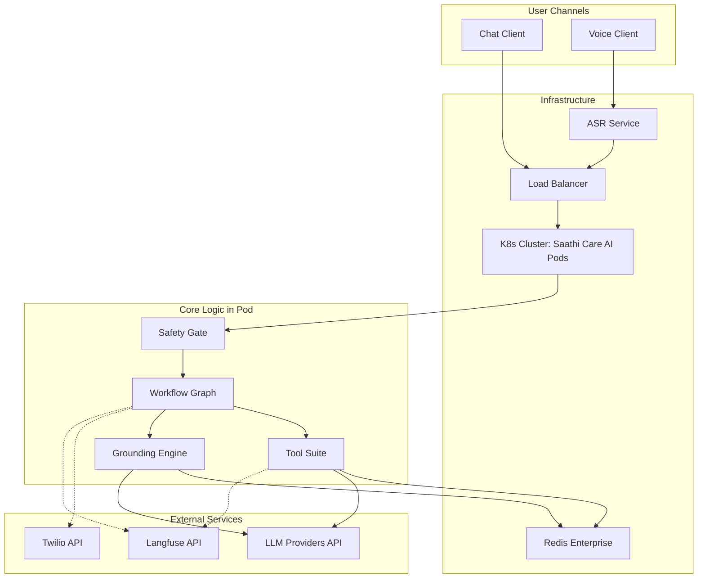

# Enterprise Architect Memo: Saathi Care AI

**To:** HeyDoc AI Steering Committee  
**From:** Enterprise AI Architect  
**Date:** 2026-11-21  
**Subject:** Production Architecture for Saathi Care AI at 15M Monthly Turns Scale

---

> **Scope of this memo.** It describes the *target production architecture* at 15M turns/month. The repository
> implements a prototype subset: the deterministic safety gate, the workflow graph (plain Python and an ADK 2.11
> wrapper with a coordinator-approval pause), lab tools with a simulated partner API, grounding (Mode A/B), an
> in-process embedding cache, redacted logging/tracing, and the evaluation harness. **Not implemented here:**
> Kubernetes, Redis, a real ASR/TTS service, DPDP consent tokens, the `/user/purge-data` erasure endpoint, a
> circuit-breaker, Twilio (the SMS is a logged mock) and real voice audio. Sections 2, 4 and 5 are design intent.
>
> **Cost figures.** Every dollar figure below is derived from per-turn costs measured with `python -m evaluations.run_evals`
> (section 3 shows the arithmetic and the assumptions). The earlier $4,980 / $28,500 projection has been removed. STT/TTS and
> Redis costs were **not measured** and are left as explicit inputs, not guessed.

### Measured LLM cost (2026-11-22, `python -m evaluations.run_evals`, gemini-3.5-flash-lite, cache off)

| Mode | Mean tokens/turn (incl. thinking) | Cost/turn | 15M wellness turns/month |
|---|---|---|---|
| A (retrieval) | 810.7 - 918.0 (3 runs) | $0.000521 - $0.000623 | ~$7,800 - $9,300 |
| B (facts + tools) | 564.8 - 640.2 (3 runs) | $0.000234 - $0.000253 | ~$3,500 - $3,800 |

Three runs on the migrated model (n=12 turns per mode each; later runs also include the retrieval and prompt-v4
changes, which answer two more questions with an LLM call, so Mode A rose slightly; treat as +/-25%). Previous model (gemini-2.5-flash, 2 runs): Mode A $0.001463-$0.001861/turn, Mode B $0.000934-$0.001220/turn.
Prices (Standard, per 1M tokens, verified 2026-11-22 on aistudio.google.com/docs/pricing): gemini-3.5-flash-lite
$0.30 in / $2.50 out; gemini-3.8-flash $0.75 / $3.75 through 2026-12-31, then $1.50 / $7.50 from 2027-01-01 (used for
the quality route and the eval judge; not in the table above); GPT-4o $2.50 / $10; GPT-4o-mini $0.15 / $0.60.
Caveats: wellness questions only (booking turns make no LLM call unless the router falls back); voice STT/TTS and
Redis costs were **not measured**; no cache saving is assumed anywhere in section 3 (measured cache hit rate ~0% at the safe 0.88 threshold). Models migrated from gemini-2.5-flash/pro per Google's deprecation page (shutdown 2026-12-01).

## 1. Executive Summary

This document outlines the production architecture for the Saathi Care AI assistant, designed to handle a target load of **15 million monthly turns** (10M chat, 5M voice). The architecture prioritizes cost efficiency, regulatory compliance under India's DPDP Act 2023, and operational resilience. By implementing a tiered model routing strategy and an intelligent caching layer, the LLM cost is projected from measured per-turn costs only (section 3); no cache saving is assumed because none was measured. The system is engineered for deterministic safety, data privacy, and robust observability from day one.

## 2. Scale & Performance Architecture

The system is designed as a containerized Python application, deployed on a managed Kubernetes cluster (e.g., GKE Autopilot, AKS) for automated scaling.

- **Target Load:** 15,000,000 turns/month
- **Peak Load Estimate:** ~15 turns/second (assuming 8-hour daily peak usage)
- **Voice Channel:** Voice input will be handled by a dedicated Speech-to-Text (ASR) service (e.g., Google Chirp, Azure Speech). The raw audio is **never** stored; only the transcript is passed to the core application.



## 3. Tiered routing and cost estimate (built on measured costs)

**Model mix (what the repo actually runs,** `config/models.yaml`**):** every production LLM call (the coach's answer, the
router's fallback classification, report explanations, grounding decisions, and safety second stage) routes through
the centralized `ADKModelGateway` (`app/workflow/gateway.py`), an implementation of Google ADK 2.11's `BaseLlm`.
For Gemini models, execution uses native ADK `google.adk.models.google_llm.Gemini` (`google.genai.Client`) with zero direct raw HTTP calls.
Cross-provider fallback (`gpt-4o-mini`, `gpt-4o`, Ollama, vLLM) executes through the gateway's multi-provider adapter with
bounded retries (max 3 retries, monotonic exponential backoff with jitter) and circuit breaker (3 consecutive failures, 30s cooldown).
Booking, safety triage, slot parsing and handoff make **no** LLM call.
A separate `voice` route now exists (same model, latency-first, wired through `WorkflowGraph(model_node="voice")`), and the same eval was run on four mixes (gemini-3.5-flash-lite, gemini-3.8-flash, gpt-4o-mini, gpt-4o): see `EVALS.md` "Model mixes" for quality, p50/p95 and cost per 1k conversations, and the routing policy. Cheapest passing mix: gpt-4o-mini ($0.19 / 1k LLM turns) but it has the worse p95; flash-lite is kept as default for its p95. Not built: streaming into TTS.

### Routing Policy Summary

| Routing Node | Primary Model | Fallback Model | Why Selected |
|---|---|---|---|
| `cost_optimized` (Chat coach, router fallback) | `gemini-3.5-flash-lite` | `gpt-4o-mini` | Fast tail latency (p95 2.8 s vs 4.2 s for OpenAI mini), 100% faithfulness, 84% lexical groundedness, very low cost ($1.19/1k conversations). Fallback to `gpt-4o-mini` provides cross-vendor resilience during outages. |
| `quality_optimized` (Report summarization, offline judge) | `gemini-3.8-flash` | `gpt-4o` | High reasoning capacity for complex clinical report analysis and offline claim-level eval judging. Fallback to `gpt-4o` prevents vendor lock-in. |
| `voice` (Voice channel: inbound / outbound calls) | `gemini-3.5-flash-lite` | `gpt-4o-mini` | Strict 1.5 s TTFA budget: fastest p95 among passing models (2,813 ms vs 4,201 ms for gpt-4o-mini and 11,679 ms for gemini-3.8-flash). Paired with 600 ms deterministic spoken filler. Fallback to `gpt-4o-mini` ensures cross-vendor continuity. |
| `safety_gate` (Triage & red flags) | None (Deterministic Rules) | None | Zero latency (<1 ms), 100% recall on emergency red flags, 0% failure rate, immune to prompt injection. |
| `lab_booking` (Catalog, slot selection, booking) | None (Deterministic Code) | None | Zero hallucination on test prices or available slots, 0% wrong-booking rate, ACID consistency with partner APIs. |

**Measured per-turn LLM cost** (latest run, 2026-11-22, n=12 wellness turns per mode, cache off): Mode A $0.000618,
Mode B $0.000251 (range over runs: A $0.00052-$0.00062, B $0.00023-$0.00026).

**Projection to 15M turns/month (10M chat + 5M voice).** Cost = turns that call the coach LLM x measured cost per turn.
The share of turns that are LLM wellness turns is an **assumption** (it depends on real traffic, which we do not have),
so three values are shown:

| Share of all turns that call the coach LLM | Mode A (retrieval) | Mode B (facts + tools) |
|---|---|---|
| 25% (3.75M turns) | ~$2,300 | ~$940 |
| 50% (7.5M turns) | ~$4,650 | ~$1,880 |
| 100% (upper bound, 15M turns) | ~$9,300 | ~$3,750 |

Arithmetic: turns x $0.00062 (A) or x $0.00025 (B). Treat as +/-25% (run-to-run variation). No cache saving is
included: the semantic cache measured ~0% hit rate at the safe 0.88 threshold, and member-specific (Mode B) answers are
never cached. These figures cover the LLM only.

**Not in the numbers (inputs to be priced, not guessed):**

- Voice STT and TTS: cost = (5M voice turns x average seconds of audio per turn) x the chosen vendor's per-minute / per-character list price. Neither the audio length nor the vendor price was measured here.
- Redis, Kubernetes/Cloud Run compute, Langfuse, egress.
- Router fallback LLM calls (a short classification) occur only when no keyword rule decides; their share of traffic was not measured.

**Latency budgets (measured vs target):**

| Path | Target | Measured |
|---|---|---|
| Booking / safety / emergency turn (no LLM) | < 100 ms workflow | p50 ~10 ms, p95 ~45 ms (voice eval, 50 turns) |
| Voice time to first audio (caller stops -> first sound) | 1.5 s | Booking turns: ~60 ms workflow + simulated STT/TTS, so within budget only *before* real STT (~400 ms) and TTS (~300 ms), which are assumed. Wellness-by-voice turns: 1.8-2.9 s before real STT/TTS, **over budget** |
| Chat wellness answer | ~3 s p50 | LLM mean 2.7-4.7 s across runs; p95 up to 12 s in a loaded run |

To bring voice wellness turns inside 1.5 s the design needs streaming tokens into TTS and a smaller/faster voice route;
neither is implemented. In production, keep Langfuse export off the request path (done for voice: it cost about 400 ms
per turn when flushed synchronously).

**Where caching and smaller models fit.** Mode B facts and all transactional turns avoid retrieval and (mostly) the LLM
altogether, which is why Mode B costs about 2.5x less per turn here. A semantic cache only helps generic Mode A
questions and only at a threshold high enough to avoid wrong-answer hits; our measured saving is ~0%, so none is claimed.
`gemini-3.5-flash-lite` is already the small model; the next saving is routing, not shrinking further.

**Deployment (design intent, not built):** Cloud Run (stateless, autoscaling, min-instances for voice) or Vertex AI Agent
Engine, with session state in Redis/Firestore; the ADK workflow is the same in either.

## 4. Health data, consent and retention under India's DPDP Act 2023 (design intent; consent, erasure and audio handling are NOT implemented)

**What we log vs mask.**

| Data | Log? | Treatment |
|---|---|---|
| Member's own words (chat text, voice transcript) | Not in plain text | **Implemented:** redacted in logs, stdout and trace spans (length + opaque tag only). Raw-text capture is an explicit opt-in (`LANGFUSE_CAPTURE_CONTENT`), off by default |
| Call audio | Never stored | Processed in memory by the ASR service and discarded; only the redacted transcript flows on. Voiceprints are biometric-adjacent, so no audio is retained for QA unless a separate explicit consent exists |
| Names, phone numbers, member ids | Pseudonymous member id only | Names/phones masked in traces; id is the join key |
| Symptoms, booking details, triage level | Triage level and booking ids yes; free-text symptoms no | Triage status and `trace_id` are enough for audit; the symptom text is not copied into logs or the emergency SMS |
| Token counts, latency, cost, model, prompt version | Yes | Not personal data |

**Consent (DPDP s.6).** Granular, purpose-specific consent recorded *before* the first health-related turn: (1) coaching,
(2) lab booking and sharing booking data with the partner lab, (3) optional QA use of transcripts. Withdrawal is as easy
as giving it and disables the matching purpose immediately.

**Retention and erasure (DPDP s.8(7), s.12-13).** Proposal, to be confirmed with the client's counsel: chat/voice turn
history 30 days, then deleted; booking records for the period the lab relationship requires; traces keep no member text, so
they can live 90 days. A `/user/purge-data` endpoint deletes turn history, drafts and cached member-specific answers
within 24 hours of a verified request. Cross-border: confirm LLM/ASR provider regions before sending health context abroad.

## 5. Top 3 production risks and how we would watch for them

_Implemented in the prototype: member message text is redacted from logs, stdout and trace spans (length + opaque tag only)._

| # | Risk | Mitigation | How we would watch it in production |
|---|---|---|---|
| 1 | Slang or code-mixed distress that the red-flag regexes miss (a false negative is the worst failure) | Daily false-negative audit queue; a second-stage classifier that can only raise the triage level (not built) | Weekly recall on a growing labelled red-flag set (target 100%); alert on any human-reviewed miss; rate of sessions the audit queue flags |
| 2 | Partner lab API 500 spike | Retries with backoff, then handoff to a care coordinator (built); circuit-breaker to stop hammering a dead API (not built) | Alert on `tool:book_test` error rate and handoff-ticket rate (the incident drill shows both: `docs/INCIDENT_DRILL.md`); coordinator queue age |
| 3 | Voice time-to-first-audio drift and wrong readings of numbers/dates | Read-back of test, date and slot plus an explicit yes (built); streaming into TTS and local TTS fallback (not built) | p95 TTFA per turn type against the 1.5 s budget; read-back correction rate (caller says "no" after a read-back); wrong-booking rate (target 0) |

## 6. As-built implementation (read from source, 2026-11-23)

Sections 1-5 are the architect memo (scale, cost, DPDP, risks). This section describes what the repository actually runs.
Where it differs from the memo's design intent, the difference is stated.

### 6.1 Workflow graph and ADK 2.11.0

`app/workflow/adk_graph.py` builds a real Google ADK 2.11.0 `Workflow` of `@node` functions. Every node calls the single set of
business-logic steps in `app/workflow/graph.py` (`WorkflowGraph.run_node`), so there is no duplicated logic between the ADK path
and the plain-Python path used by tests and evals.

```
START -> safety_gate -> emergency
                     -> intent_router -> program_coach
                                      -> lab_booking -> handoff_request -> (pause: RequestInput) -> handoff_resolution
```

Code decides: red-flag escalation, the diagnosis/medication refusal, slot parsing and read-back, the "explicit yes", every tool
call and its arguments, retries, and the handoff trigger. The LLM only words wellness answers, classifies an intent when no rule
decides, and acts as a second safety stage that can only **raise** the triage level. Human approval of a failed booking uses ADK
`RequestInput`: the workflow genuinely pauses and resumes. Logs show an ADK warning ("Node 'lab_booking' has conditional/DEFAULT
edges but none were matched ... The branch will end"); it did not fail any test and has not been root-caused.

### 6.2 Model gateway and remaining bypasses

`ADKModelGateway(BaseLlm)` in `app/workflow/gateway.py` is the only place a `ModelClient` is constructed or called (source search
of `app/`, 2026-11-23). The coach, router fallback, grounding planner, safety second stage and report explainer all use it.

- **Gemini generation:** executed by ADK's native `google.adk.models.google_llm.Gemini` inside `ModelClient`.
- **OpenAI, Ollama, vLLM generation:** the project's own `requests` calls in `model_client.py`. This is not ADK networking.
- **Bypass, stated plainly:** the semantic-cache **embedding** request (`app/grounding/semantic_cache.py`) is a direct
`requests.post` to the Gemini embeddings API. It is not generation and gets no gateway retry or fallback; a failure degrades the
cache to token-overlap matching. `tests/test_centralized_adk_gateway.py::test_provider_http_egress_is_confined_to_known_files`
fails if any other file starts talking to a provider.
- Resilience: at most 3 retries with exponential backoff and proportional jitter, per-call timeout, vendor fallback by routing
node (`config/models.yaml`), circuit breaker. Emergency detection never depends on the gateway.

### 6.3 Session state and persistence

Typed Pydantic V2 state (`app/workflow/state.py`) is held per session. The API stores sessions, members, confirmed bookings and an
emergency-alert audit trail in SQLite through one `Store` interface (`app/persistence/store.py`; Postgres would be an
implementation swap). Session tokens are stored only as SHA-256 hashes; sessions expire after `SESSION_TTL_MINUTES` idle (default
120) and are capped (`MAX_SESSIONS`, default 200); creation and message rates are limited. A different member's token gets 401.
Message text is stored as typed (it is the conversation), so the database volume must be encrypted and retention applied (section 4).

### 6.4 RAG and non-RAG modes

`GROUNDING_MODE=mode_a_rag|mode_b_facts`, switchable per session from the UI.
Mode A: an agent loop plans a retrieval query from a fixed whitelist, searches a pluggable retriever (lexical by default,
`RETRIEVER=embedding` available), may re-search, and must cite `[DOC_id]`; citations are verified against retrieved documents.
Mode B: no retrieval; backend tools return the member's profile, bookings, schedule and the lab catalogue, and the model may answer
only from those facts or say it does not know. Measured trade-offs are in `EVALS.md`.

### 6.5 Booking flow and idempotency

Generic request -> candidate packages -> member picks one -> slot (fasting tests only offer morning slots) -> read-back -> explicit
yes -> `book_test`. `book_test` retries up to 3 times with exponential backoff and sends a **stable idempotency key**
(`member:package:date:slot`) on every attempt, so a retry after a timeout cannot create a second partner booking. A taken slot is
refused locally and by the partner (409). After retries are exhausted the workflow raises a human-handoff ticket. A repeated "yes"
after booking answers "nothing pending" (verified by API test and browser test). The partner API is a **simulator** by default;
`LAB_FAILURE_RATE` (default 0, the brief's 15% needs `0.15`) injects failures; `LAB_BACKEND=http` selects an HTTP adapter that has
not been run against a real partner.

### 6.6 Voice

Chat and voice share one workflow (`app/channels/voice_agent.py` drives `execute_turn`). In the browser, speech-to-text and
text-to-speech are the browser's Web Speech engines; the UI shows a real microphone level, live transcript, mute, interrupt
(barge-in cancels speech without losing state), low-confidence guard and booking read-back. The backend `VoiceAgent` used by evals
and `voice_demo.py` **simulates** STT/TTS, so its latency numbers exclude real audio. No telephony provider is integrated; the
outbound reminder call is a simulation. The Talk to Mimi voice screen is separate from Mimi, who is only the chat persona.

### 6.7 Observability

`app/observability/tracer.py` writes one span per node, tool and model call to `logs/traces.jsonl`, all sharing the turn's
`trace_id`, with model, tokens, cost and latency on LLM spans. With `LANGFUSE_PUBLIC_KEY`/`LANGFUSE_SECRET_KEY` set, spans are also
exported to Langfuse 4.x (LLM spans as generations). Content is redacted by default (`LANGFUSE_CAPTURE_CONTENT=false`). Export
failures are counted and never break a turn. Export to a live Langfuse project was not inspected in this verification pass.

### 6.8 Semantic cache

Embedding cosine similarity, threshold 0.88, TTL 3600 s, namespaced by prompt version and embedding model, optional Redis backend
(stores only the embedding and a generic answer, never question text). Only generic Mode A answers are cached; member-data,
booking and PII-like queries bypass it, so no member-specific answer is shared across members.

### 6.9 Scale and privacy

The 15M interactions/month plan, routing and cost projection are sections 2-3; DPDP consent, retention and erasure are section 4.
They are design and cost modelling; **no load test was run**. The prototype's in-process rate limits and SQLite are not
multi-instance safe, which is why section 2 moves session state to Redis/Postgres.
