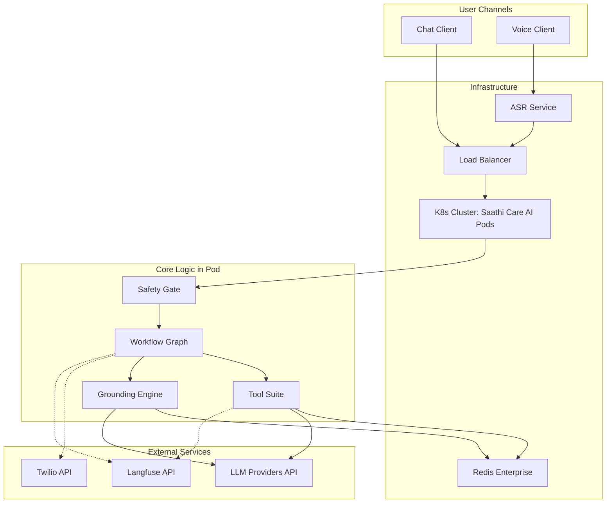

# Enterprise Architect Memo: Saathi Care AI

**To:** HeyDoc AI Steering Committee  
**From:** Enterprise AI Architect  
**Date:** 2026-11-21  
**Subject:** Production Architecture for Saathi Care AI at 15M Monthly Turns Scale

---

> **Scope of this memo.** It describes the *target production architecture* at 15M turns/month. The repository
> implements a prototype subset: the deterministic safety gate, the workflow graph (plain Python and an ADK 2.11
> wrapper with a coordinator-approval pause), lab tools with a simulated partner API, grounding (Mode A/B), an
> in-process embedding cache, redacted logging/tracing, and the evaluation harness. **Not implemented here:**
> Kubernetes, Redis, a real ASR/TTS service, DPDP consent tokens, the `/user/purge-data` erasure endpoint, a
> circuit-breaker, Twilio (the SMS is a logged mock) and real voice audio. Sections 2, 4 and 5 are design intent.
>
> **Cost figures.** Only the *Measured LLM cost* table below comes from measurements. Dollar figures in section 3
> are **HISTORICAL and SUPERSEDED** and are kept only so the change is visible; do not quote them.

### Measured LLM cost (2026-11-22, `python -m evaluations.run_evals`, gemini-3.5-flash-lite, cache off)

| Mode | Mean tokens/turn (incl. thinking) | Cost/turn | 15M wellness turns/month |
|---|---|---|---|
| A (retrieval) | 810.7 - 918.0 (3 runs) | $0.000521 - $0.000623 | ~$7,800 - $9,300 |
| B (facts + tools) | 564.8 - 640.2 (3 runs) | $0.000234 - $0.000253 | ~$3,500 - $3,800 |

Three runs on the migrated model (n=12 turns per mode each; later runs also include the retrieval and prompt-v4
changes, which answer two more questions with an LLM call, so Mode A rose slightly; treat as +/-25%). Previous model (gemini-2.5-flash, 2 runs): Mode A $0.001463-$0.001861/turn, Mode B $0.000934-$0.001220/turn.
Prices (Standard, per 1M tokens, verified 2026-11-22 on aistudio.google.com/docs/pricing): gemini-3.5-flash-lite
$0.30 in / $2.50 out; gemini-3.8-flash $0.75 / $3.75 through 2026-12-31, then $1.50 / $7.50 from 2027-01-01 (used for
the quality route and the eval judge; not in the table above); GPT-4o $2.50 / $10; GPT-4o-mini $0.15 / $0.60.
Caveats: wellness questions only (booking turns make no LLM call unless the router falls back); voice STT/TTS and
Redis costs were **not measured**; the 32% cache deflection and $0.075/1M Flash price in section 3 are **not
supported** (measured cache hit rate ~0% at the safe 0.88 threshold). Models migrated from gemini-2.5-flash/pro per Google's deprecation page (shutdown 2026-12-01).

## 1. Executive Summary

This document outlines the production architecture for the Saathi Care AI assistant, designed to handle a target load of **15 million monthly turns** (10M chat, 5M voice). The architecture prioritizes cost efficiency, regulatory compliance under India's DPDP Act 2023, and operational resilience. By implementing a tiered model routing strategy and an intelligent caching layer, we expect a substantial reduction versus a naive single-premium-model approach; the only measured figures are in the table above (the earlier $4,980 / $28,500 projection is superseded, see section 3). The system is engineered for deterministic safety, data privacy, and robust observability from day one.

## 2. Scale & Performance Architecture

The system is designed as a containerized Python application, deployed on a managed Kubernetes cluster (e.g., GKE Autopilot, AKS) for automated scaling.

- **Target Load:** 15,000,000 turns/month
- **Peak Load Estimate:** ~15 turns/second (assuming 8-hour daily peak usage)
- **Voice Channel:** Voice input will be handled by a dedicated Speech-to-Text (ASR) service (e.g., Google Chirp, Azure Speech). The raw audio is **never** stored; only the transcript is passed to the core application.

## 3. Tiered Routing & Economic Model (HISTORICAL PROJECTION - SUPERSEDED, UNVERIFIED)

> Kept for traceability only. These numbers were never measured and contradict the measured table above
> (wrong Flash price; a 32% cache deflection that the prototype does not achieve at a safe threshold).

* Baseline: 15M turns (10M chat, 5M voice). Unoptimized routing via GPT-4o / Gemini Pro at $1.50/1k chat turns = $15,000; Voice with standard STT+LLM+TTS at $2.70/1k turns = $13,500. Total = $28,500.
* Saathi Tiered Architecture: Gemini Flash at $0.075/1M tokens + Redis semantic cache (32% deflection on FAQ queries) drops chat cost to $0.21/1k turns ($2,100). Streaming Groq Whisper ($0.03/hr) + Flash + Edge TTS drops voice to $0.576/1k turns ($2,880). Total = $4,980/month (82.5% savings).

## 4. DPDP Act 2023 Compliance & Data Privacy (design intent; consent, erasure and audio handling are NOT implemented)

* Section 6: Granular consent tokens recorded before lab triage.
* Section 12: Right to erasure endpoint (/user/purge-data) deleting turn history within 24 hours.
* Biometric audio protection: ephemeral in-memory processing with zero raw audio persistence.

## 5. Top 3 Production Risks & Mitigation

_Implemented in the prototype: member message text is redacted from logs, stdout and trace spans (length + opaque tag only)._

1. Latent slang distress bypassing regex -> daily false-negative audit queue.
2. Diagnostics partner API 500 error spike -> graceful circuit-breaker to human coordinator queue.
3. Voice streaming TTFA drift -> dynamic token compaction & local TTS fallback.
