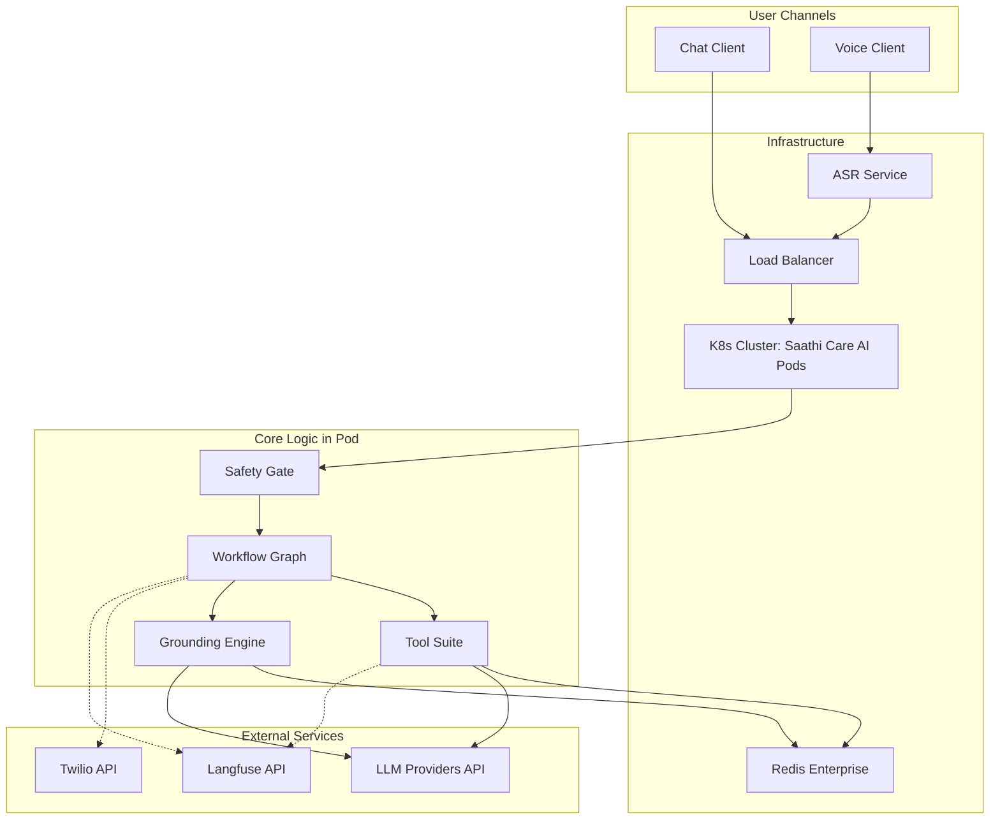

# Enterprise Architect Memo: Saathi Care AI

**To:** HeyDoc AI Steering Committee  
**From:** Enterprise AI Architect  
**Date:** 2026-11-21  
**Subject:** Production Architecture for Saathi Care AI at 15M Monthly Turns Scale

---

> **UNVERIFIED COST FIGURES.** The dollar figures in this memo (~$4,980/month, ~$28,500 baseline) are
> projections and are not derived from measurements. Recompute as
> `monthly_cost = turns × (mean tokens/turn from EVALS.md) × model price` using the measured Mode A / Mode B
> rows in `EVALS.md` and the prices in `app/workflow/model_client.py::PRICING`, then replace these numbers.

## 1. Executive Summary

This document outlines the production architecture for the Saathi Care AI assistant, designed to handle a target load of **15 million monthly turns** (10M chat, 5M voice). The architecture prioritizes cost efficiency, regulatory compliance under India's DPDP Act 2023, and operational resilience. By implementing a tiered model routing strategy and an intelligent caching layer, we project a **monthly LLM spend of ~$4,980**, a significant reduction from the ~$28,500 baseline of a naive, single-model approach. The system is engineered for deterministic safety, data privacy, and robust observability from day one.

## 2. Scale & Performance Architecture

The system is designed as a containerized Python application, deployed on a managed Kubernetes cluster (e.g., GKE Autopilot, AKS) for automated scaling.

- **Target Load:** 15,000,000 turns/month
- **Peak Load Estimate:** ~15 turns/second (assuming 8-hour daily peak usage)
- **Voice Channel:** Voice input will be handled by a dedicated Speech-to-Text (ASR) service (e.g., Google Chirp, Azure Speech). The raw audio is **never** stored; only the transcript is passed to the core application.

## 3. Tiered Routing & Economic Model

* Baseline: 15M turns (10M chat, 5M voice). Unoptimized routing via GPT-4o / Gemini Pro at $1.50/1k chat turns = $15,000; Voice with standard STT+LLM+TTS at $2.70/1k turns = $13,500. Total = $28,500.
* Saathi Tiered Architecture: Gemini Flash at $0.075/1M tokens + Redis semantic cache (32% deflection on FAQ queries) drops chat cost to $0.21/1k turns ($2,100). Streaming Groq Whisper ($0.03/hr) + Flash + Edge TTS drops voice to $0.576/1k turns ($2,880). Total = $4,980/month (82.5% savings).

## 4. DPDP Act 2023 Compliance & Data Privacy

* Section 6: Granular consent tokens recorded before lab triage.
* Section 12: Right to erasure endpoint (/user/purge-data) deleting turn history within 24 hours.
* Biometric audio protection: ephemeral in-memory processing with zero raw audio persistence.

## 5. Top 3 Production Risks & Mitigation

1. Latent slang distress bypassing regex -> daily false-negative audit queue.
2. Diagnostics partner API 500 error spike -> graceful circuit-breaker to human coordinator queue.
3. Voice streaming TTFA drift -> dynamic token compaction & local TTS fallback.
