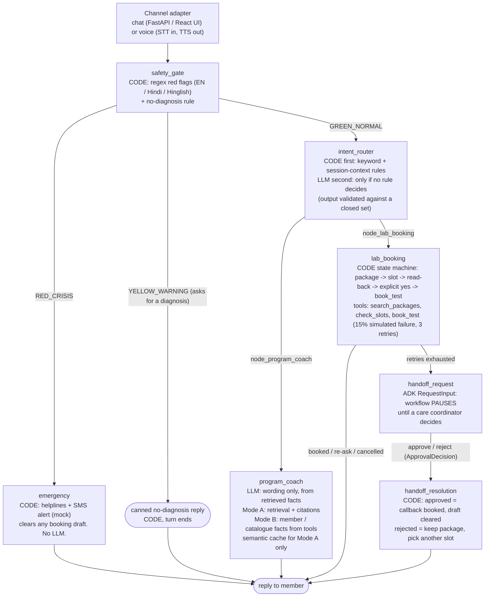

# Saathi Care AI - Architectural Plan

> **Status note.** `PLAN.md` is the first commit in this repository (`6adfa01`). This version has since been rewritten to
> describe what is actually built (ADK 2.x Workflow with a human-approval pause), not the first sketch (a plain DAG
> with a regex-only router); see `git log -- PLAN.md` for the original.

## 1. Problem
A yoga and wellness company serves hundreds of thousands of members over chat, WhatsApp-style messaging and phone calls
in English, Hindi and Hinglish. One assistant must (a) answer program questions grounded only in the company's data,
(b) recommend and book lab tests, (c) never diagnose, (d) escalate red-flag symptoms immediately, and (e) let each step
run on a different model, because at millions of conversations a month cost matters as much as quality.

The design tension: LLMs are good at fluent, empathetic wording and bad at guarantees. Safety and money-moving actions
need guarantees, so they are code; the LLM is confined to wording.

## 2. Users
- **Member** - wants a quick booking, an answer about a practice, or help with a symptom. Needs a safe, short, correct reply.
- **Care coordinator (human in the loop)** - receives a ticket when a booking cannot be completed or when an emergency is flagged, and approves or rejects the callback.
- **AI engineer / on-call** - needs every turn traceable (`trace_id` on every node, tool and model call) and every behaviour covered by an eval.

## 3. Workflow graph (Google ADK 2.x `Workflow`, `app/workflow/adk_graph.py`)

Chat and voice enter through the **same** workflow; only the channel adapter at the edge differs
(`app/api.py` for chat/UI, `app/channels/voice_agent.py` for voice).

Node names in code: `safety_gate`, `emergency`, `intent_router`, `program_coach`, `lab_booking`, `handoff_request`,
`handoff_resolution`. All business logic lives once in `app/workflow/graph.py`; each ADK node calls
`WorkflowGraph(chain=False).run_node(...)` for exactly one step and routes on `session.next_node`, so the plain-Python
runner (used by evals, voice, CLI) and the ADK runner cannot drift apart.

## 4. Which decisions are code and which are LLM, and why

| Decision | Code or LLM | Why |
|---|---|---|
| Red-flag escalation (chest pain, fainting, breathlessness, self-harm, bleeding) | **Code** (regex; variants listed explicitly, no fuzzy matching) | Recall must be 100% and the same every time. A model can be talked out of it or have a bad day. |
| "No diagnosis" refusal | **Code** (deterministic trigger + canned reply) | A violation is a clinical and legal event, so it is not left to prompt wording. The coach prompt repeats the rule as defence in depth. |
| Safety gate, second stage | **Code first, LLM second** | The LLM classifier acts as a second stage behind the regexes to catch slang or phrasing the regex misses. It can only *raise* the triage level (e.g. to RED_CRISIS), never lower it. |
| Intent routing | **Code first, LLM second** | Keyword and session-context rules decide almost every turn at zero cost and zero latency. The LLM classifier runs only when no rule decides, and its label is accepted only if it is one of two known values, so prompt injection cannot invent a route. |
| Booking state machine, slot parsing, read-back, "explicit yes" | **Code** | Money-moving and irreversible. Number words become integers, so "fifteen" can never match "fifty". Only a whole-word yes with no negation books. |
| Tool calls (`search_packages`, `check_slots`, `book_test`) | **Code** | The LLM never chooses a tool or its arguments; arguments come from parsed state. Retries/backoff and the human handoff are plain Python. |
| Handoff approval | **Human** (ADK `RequestInput`) | A person decides; the workflow genuinely pauses and resumes. (Auth is a shared secret in this prototype, not real identity.) |
| Wellness answer wording | **LLM** (`program_coach`) | Fluent, empathetic, multilingual wording is what the model is for. It sees only the retrieved facts, must cite `[DOC_id]`, and says "I don't have that information" otherwise. |
| Mode B facts (member profile, schedule, catalogue, bookings) | **Code** fetches, **LLM** words them | Facts come from the backend, not from model memory. |

## 5. State and data model
Typed Pydantic V2 models (`app/workflow/state.py`), serialisable so the ADK session holds them between turns:
- `UserSessionState`: `session_id`, `channel` (chat / voice / eval), `member`, `booking_draft`, `triage_status`, `active_node`, `next_node`, `trace_id`, `handoff_ticket`, `grounding_mode`, `reply_lang`, `turn_history`.
- `MemberProfile` (name, age, programs, language preference, past bookings, goals) and `BookingDraft` (package, date, slot, `verbal_confirmed`, candidate packages) are used across turns: a member's name, language and booking history change the replies.
- Synthetic data in `data/`: 15 program/FAQ documents, 12 lab packages, a small member database.

## 6. Grounding modes (config: `GROUNDING_MODE=mode_a_rag|mode_b_facts`, per-session `grounding_mode`)
- **Mode A - agentic RAG:** an agent loop (max 3 steps) decides whether to retrieve, what to search for, reads which documents came back, and either searches again with a better query or stops and answers; code falls back to the member's own words if it finds nothing. Retrieval goes through a pluggable `Retriever` interface (`app/grounding/retriever.py`): `RETRIEVER=lexical` (default: stemming + Hinglish lexicon, no index) or `RETRIEVER=embedding` (dense, in-memory index, lexical fallback if embeddings are down; swap in a vector database behind the same interface for a large library). Answers cite `[DOC_ID]`. The semantic cache sits in front of Mode A only.
- **Mode B - no RAG, fact-grounded prompting:** no retrieval at all. A planner LLM call picks backend tools (`get_member_profile`, `get_bookings`, `get_schedule`, `get_catalogue`); code executes them and injects the JSON facts into `coach_facts_prompt.txt`, which allows answering only from those facts and otherwise requires "I don't have that information."
- The planner can only choose from a fixed whitelist (validated Pydantic models), so an injection cannot make it call anything else. With no LLM (no key, outage, voice channel, `AGENTIC_GROUNDING=0`) the same choices are made by deterministic rules. Each turn records what the coach saw in `session.last_grounding` (query, tools, sources) and in spans.
- Both are run through the same evals; the measured comparison and the "when I would recommend each" paragraph are in `EVALS.md`.

## 7. Model routing (`config/models.yaml`, no code change to swap)
Routing entries (cost_optimized, quality_optimized, voice, plus eval-only mixes): `cost_optimized` (`gemini-3.5-flash-lite`, fallback `gpt-4o-mini`) for the coach and the router fallback, and `quality_optimized` (`gemini-3.8-flash`, fallback `gpt-4o`) for the eval judge. The client accepts a `node` name, so a separate `voice` entry can be added in the YAML alone. **Done (2026-11-22):** the same eval on four mixes (two Google, two OpenAI) with quality, p50/p95 and cost per 1,000 conversations, a routing policy table and a separate `voice` route; see `EVALS.md` "Model mixes". Voice wellness turns meet the 1.5 s first-audio budget through a deterministic spoken filler (section 8); streaming into TTS is still not built.

## 8. Voice
Speech in -> same workflow -> speech out. Time-to-first-audio budget **1.5 s** (STT ~400 ms + workflow <= 600 ms + TTS first byte ~300 ms + slack). Read-back of test, date and slot plus an explicit "yes" before `book_test`; barge-in cancels TTS without losing state. If the workflow has not answered after 600 ms (an LLM turn), the adapter speaks a fixed filler ("One moment, let me check"); booking and emergency replies are fast and never get one. STT/TTS are **simulated** in this repo; measured results and what is not measured are in `EVALS.md` (Voice section).

## 9. Observability
One root span per turn, a child span for every node, tool and LLM call, all carrying the same `trace_id`; LLM spans record model, tokens, cost and latency. Spans go to `logs/traces.jsonl` and to Langfuse when keys are set. The incident drill that uses these traces is in `docs/INCIDENT_DRILL.md`.

## 10. Cost estimate
Measured, not guessed: see `ARCHITECTURE.md` section 3 (cost per turn per mode from `python -m evaluations.run_evals`, scaled to 15M turns/month with the assumptions stated there). Voice STT/TTS and Redis costs are not measured and are labelled as assumptions.

### Citations (verified by code, shown in the UI)
The coach is asked to cite `[PROG_..]` (Mode A) or `[bookings]`, `[lab_catalogue]`, ... (Mode B), but the model is not trusted: `app/grounding/citations.py` checks every cited id against the context the model was actually given. Unknown ids are stripped and recorded (`fabricated_citations` on the trace); an answer that cites nothing still shows its sources as "consulted". The API returns typed `citations` + a `grounding` summary on each coach message; the chat shows source chips and a "How I answered" panel (mode, searches or lookups, who decided); voice never speaks the markers. Eval columns: answers citing a verified source, fabricated citations.

## 11. Implementation status (2026-11-23) and trade-offs

Status labels: VERIFIED = executed in the 2026-11-23 verification pass (evidence in `SUBMISSION_READINESS_REPORT.md`);
NOT LIVE-VERIFIED = implemented, tested only with doubles or simulators.

| Requirement | Status |
|---|---|
| ADK 2.11.0 `Workflow` with `@node`s, handoff via `RequestInput` | VERIFIED |
| Single model gateway (`ADKModelGateway`); native ADK `Gemini` for Gemini; OpenAI/Ollama/vLLM via `requests` | VERIFIED by source search. Embedding calls bypass the gateway |
| Program Coach, Lab Booking with `search_packages` / `check_slots` / `book_test`, explicit confirmation, idempotency key | VERIFIED (API + browser) |
| Simulated 15% booking failure | Mechanism VERIFIED; **default is 0**, set `LAB_FAILURE_RATE=0.15` |
| Human handoff with coordinator approve/reject | VERIFIED in browser against a stack where every lab call fails |
| Shared chat/voice workflow; member-scoped sessions | VERIFIED (other member's token -> 401) |
| Mode A (RAG, citations) and Mode B (facts + tools) | VERIFIED, measured in `EVALS.md` |
| Versioned prompts, injection resistance | VERIFIED by tests and the prompt-iteration snapshot of 2026-11-22 |
| Semantic cache without member leakage | VERIFIED by tests; Redis path with fakeredis only |
| Langfuse | Local spans VERIFIED; Langfuse cloud export NOT LIVE-VERIFIED |
| Voice: browser STT/TTS, barge-in, read-back, explicit confirm | VERIFIED with a fake microphone and speech doubles; real speech/telephony NOT LIVE-VERIFIED |
| 15M interactions/month architecture | Design and cost model only; no load test |

### Trade-offs taken
- **Code over LLM for anything irreversible or safety-critical.** Costs flexibility (a new phrasing needs a rule) and recall is
  only as good as the regex list; the LLM second stage can raise but never lower triage.
- **Simulated partner API and SQLite.** Keeps the prototype self-contained and testable; not multi-instance safe, and the HTTP
  adapter has never met a real partner.
- **Lexical retrieval by default.** Cheap and deterministic with a small library; weaker on paraphrase than embeddings.
- **flash-lite as default model.** Lowest p95 among mixes that passed the gates; quality could not be ranked at n=12.
- **Voice latency budget met by a spoken filler**, not streaming: the full answer still takes about 2 s.
- **Known gaps:** lexical groundedness proxy below its 80% target in the latest run; single human annotator for judge calibration;
  no demo video.
